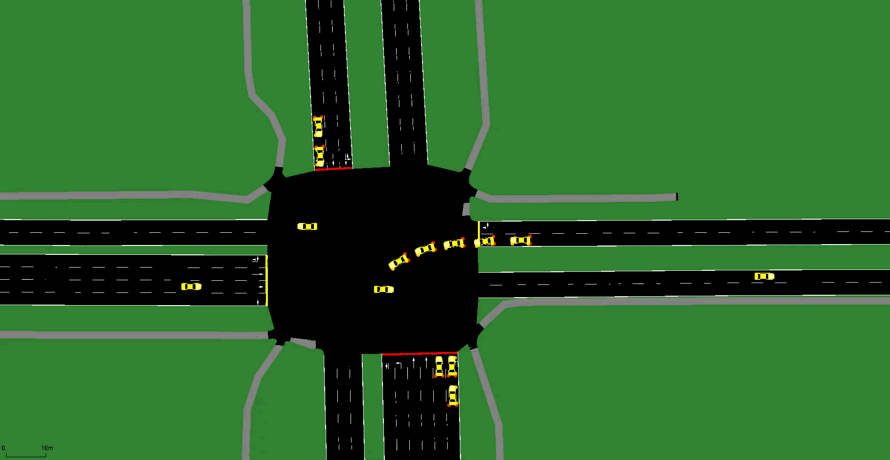

# Traffic AI

## Vehicle Detection and Tracking

https://github.com/user-attachments/assets/ce205427-95f2-4b30-abc5-807100a5331c

## Reinforcement Learning Traffic Control

Vehicle detection, multi-camera tracking visualization, and reinforcement learning traffic-signal control.

This project includes two demos:

- **Video analysis:** Detects and tracks vehicles within four camera views using RF-DETR, with adjustable camera synchronization, vehicle counts, tracking logs, and demand-based traffic-signal visualization. An optional YOLO model is also provided.
- **SUMO simulation:** Uses a trained Proximal Policy Optimization (PPO) agent to select traffic-signal phases in a simulated intersection.

Built with Python, ONNX Runtime, OpenCV, Ultralytics, SUMO-RL, and Stable-Baselines3.

## Downloads

[Download RF-DETR model] https://github.com/EvanPalskoi/Traffic-AI/releases/download/v1.0.0/rfdetr-large.onnx

[Watch or download the demo] https://github.com/EvanPalskoi/Traffic-AI/releases/download/v1.0.0/combined_intersection_demo.mp4

[Download optional YOLO model] https://github.com/EvanPalskoi/Traffic-AI/releases/download/v1.0.0/best.pt
